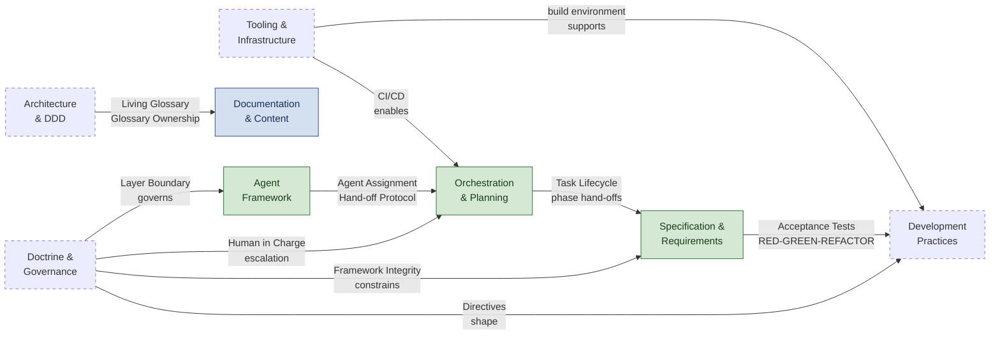

<!--
████          R E G N O L O G Y
    ██        Professional Services
████
    ██        professional_services@regnology.net
-->

# Doctrine Glossary - PS layer

**Version:** 0.4.0
**Status:** candidate — pending HiC review

---

## About This Glossary

This directory contains the **PS** slice of the federated Regnology agent-framework glossary. After the 2026-06-19 doctrine migration, the cross-cutting (All-Company) domains were promoted up to the `regnology-all-company` pack (in the sibling `skills` repository); the four domains here remain PS-specific because their terminology is tightly bound to the Professional Services delivery model.

Each domain is maintained as a standalone `README.md` in its own subdirectory. Navigate to a domain file to browse or add terms. All new terms carry `status: candidate` and require Human-in-Charge review before promotion to `canonical`.

---

## Domain Index - PS layer (this pack)

| Domain Slug | Human Name | Term Count | Description |
|---|---|---|---|
| [`agent-framework`](./agent-framework/README.md) | Agent Framework | 59 | Everything pertaining to agents as first-class entities — their named roles, profiles, operational reasoning modes, agent capability definitions, autonomy governance, collaboration contracts, and specialization hierarchy. |
| [`orchestration`](./orchestration/README.md) | Orchestration & Planning | 55 | Multi-agent task coordination, file-based collaboration, task lifecycle management, planning cycles, workflow execution, autonomous operation protocols, and cross-agent handoffs. |
| [`specification`](./specification/README.md) | Specification & Requirements | 47 | Specification-driven development, requirements engineering, acceptance criteria, the six-phase spec-driven cycle, phase protocols, evidence-based requirements methodology, and functional specification patterns. |
| [`documentation`](./documentation/README.md) | Documentation & Content | 42 | Documentation quality, content curation, writing conventions, voice preservation, artifact management, style analysis, glossary operations, and the review/audit practices that maintain documentation integrity. |

## Domain Index - All-Company layer (inherited via the `regnology-all-company` pack)

Four cross-cutting domains were promoted to the All-Company layer and are inherited at runtime when this pack is loaded together with `regnology-all-company` (see this repo's `.kittify/config.yaml -> doctrine.org.packs`). Their READMEs live in the sibling skills repo at `skills/pack/glossary/`.

| Domain Slug | Human Name | Term Count | Layer |
|---|---|---|---|
| `architecture-ddd` | Architecture & Domain-Driven Design | 58 | All-Company (`regnology-all-company`) |
| `development-practices` | Development Practices | 98 | All-Company (`regnology-all-company`) |
| `doctrine-governance` | Doctrine & Governance | 47 | All-Company (`regnology-all-company`) |
| `tooling` | Tooling & Infrastructure | 71 | All-Company (`regnology-all-company`) |

---

> Inter-domain relationships across the 8 doctrine glossary domains, with Doctrine & Governance as the cross-cutting authority layer. Solid borders = PS (this pack); dashed borders = All-Company (inherited).

---

## Navigation - PS domains

- [Agent Framework](./agent-framework/README.md)
- [Orchestration & Planning](./orchestration/README.md)
- [Specification & Requirements](./specification/README.md)
- [Documentation & Content](./documentation/README.md)

For the four All-Company domains, see `skills/pack/glossary/` in the sibling skills repository.

---

*All new terminology is marked `status: candidate` pending Human-in-Charge review.*
